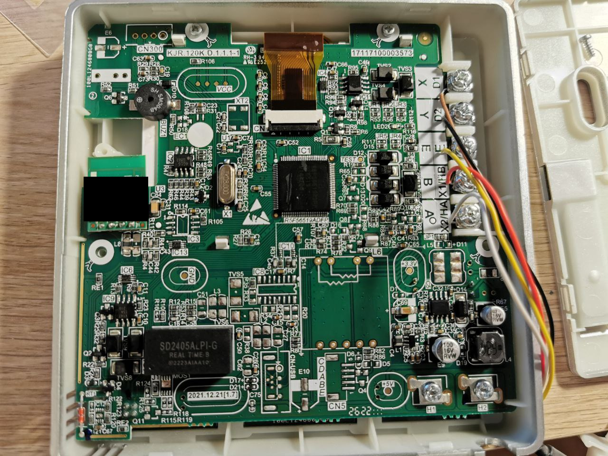
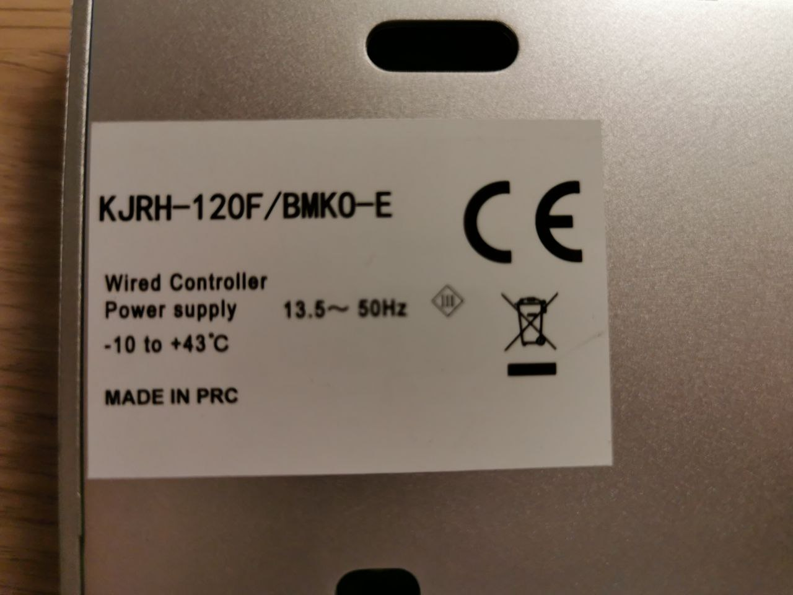
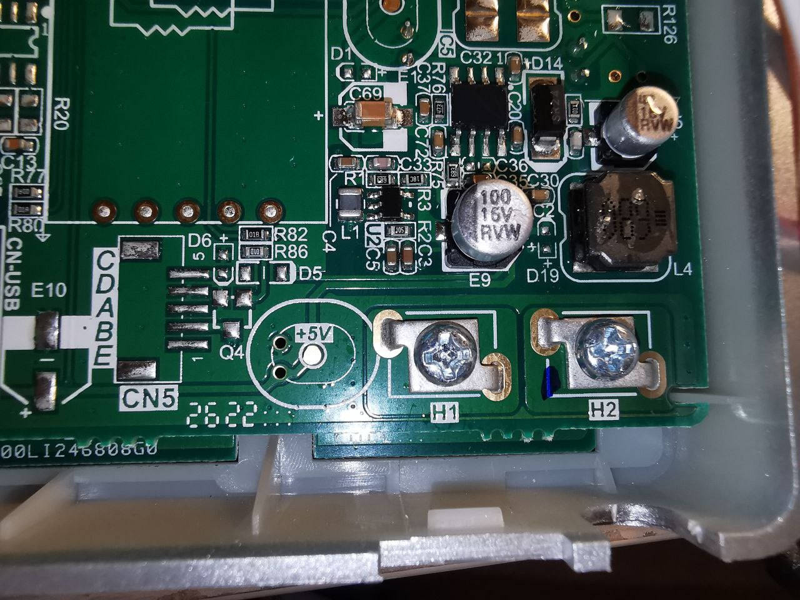
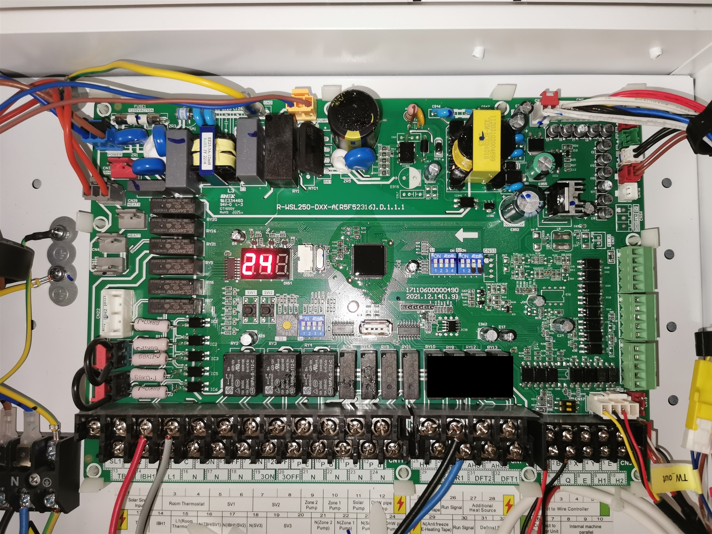

# HMI KJRH-120F/BMK0-E: RS485 Wiring and Photos

## English

### Identify The Controller

The reference installation connects the ESPHome RS485 interface to **H1/H2 on the back of the original wired HMI/controller**, not directly to the hydronic control board. The original HMI remains connected and in use.

| Identification | Reference installation |
| --- | --- |
| HMI product model, rear label | **`KJRH-120F/BMK0-E`** |
| PCB silkscreen marking | `KJR.120K.D.1.1.1-1` |
| Modbus data terminals | `H1` and `H2`, lower right of the HMI PCB in the photos |
| Working serial settings | Modbus RTU, `9600 8N1`, slave address `1` |

The product model and the PCB marking identify different things. Compare the rear product label, PCB layout and connector labels when assessing another controller. A similar-looking PCB, matching HMI model or shared heat-pump brand does not by itself validate another unit's Modbus register map.

### Access And Wiring

1. Isolate the heat pump power before opening the HMI or changing any wiring. Electrical enclosures can contain hazardous voltages; use a qualified installer if necessary.
2. Open/remove the HMI housing to access its rear PCB. Do not remove the original controller from the system or disconnect its five-wire link for normal operation.
3. Locate the separate `H1/H2` screw-terminal pair shown in the close-up. These are the terminals used by this project.
4. Connect the RS485 adapter's data pair according to the HMI and adapter documentation. The reference HMI wiring diagram labels **`H2` as `A+` and `H1` as `B-`**. Adapter `A/B` naming is not consistent across manufacturers; verify polarity rather than matching letters alone.
5. Keep any communication-reference connection consistent with both devices' documentation. It is not a third data line and must not be assumed to be protective earth.
6. Use one Modbus master only. Disconnect or stop any previous USB/RS485 polling host before enabling ESPHome polling on the same bus.

**Do not connect the adapter to `A/B` on the HMI-to-hydronic-board five-wire `A/B/X/Y/E` link.** That link includes the HMI power supply and is not the Modbus data pair used here. Likewise, similarly named `H1/H2` terminals on the hydronic board or another controller are not automatically equivalent to this HMI port.

If polling fails, stop and check the exact controller model, terminal function, power, address and serial settings. Recheck the documented polarity with power isolated before altering the data pair; do not experiment with unrelated terminals.

### First Read-Only Checks

Use the validated `9600 8N1`, address `1` settings only as a baseline for the reference installation. Confirm the settings on the target unit, then compare water inlet/outlet temperatures, outdoor temperature, operating mode and fault state with its HMI before testing writes. Visual similarity does not establish Vulcano or other rebrand compatibility.

For a compatibility report, provide the heat-pump brand/model, HMI product model, PCB marking, terminal labels and read-only results. Redact serials, QR codes, MAC addresses and private installation details from photos.

## Reference Photos / Foto Di Riferimento

These are photographs of the reference hardware. Unique identifiers have been covered where present; technical PCB markings and connector labels remain visible. The terminal close-up shows `H1/H2` before the RS485 wires were attached.

### Complete HMI PCB / Scheda HMI Completa

### Product Model / Modello Del Prodotto

### Actual Modbus Terminals / Morsetti Modbus Usati

### Hydronic Board, Comparison Only / Scheda Idronica, Solo Per Confronto

This is the board inside the hydronic unit, **not the connection point used for the adapter in this project**. The identifying sticker and QR code are covered.

## Italiano

### Identificare Il Controller

Il collegamento validato porta l'interfaccia RS485 ESPHome ai morsetti **H1/H2 sul retro dell'HMI/controller cablato originale**, non direttamente alla scheda idronica. L'HMI originale resta collegato e operativo.

| Identificazione | Installazione di riferimento |
| --- | --- |
| Modello HMI sull'etichetta posteriore | **`KJRH-120F/BMK0-E`** |
| Serigrafia del PCB | `KJR.120K.D.1.1.1-1` |
| Morsetti dati Modbus | `H1` e `H2`, in basso a destra sul PCB nelle foto |
| Parametri seriali funzionanti | Modbus RTU, `9600 8N1`, indirizzo slave `1` |

Il modello commerciale dell'HMI e la serigrafia del PCB sono riferimenti distinti. Per confrontare un altro controller verificare etichetta, disposizione dei componenti e sigle dei connettori. La somiglianza della scheda, lo stesso modello HMI o lo stesso marchio della PDC non validano da soli la mappa registri di un'altra macchina.

### Accesso E Collegamento

1. Disalimentare la pompa di calore prima di aprire l'HMI o modificare il cablaggio. Nei quadri possono essere presenti tensioni pericolose; rivolgersi a un installatore qualificato quando necessario.
2. Aprire/smontare l'involucro dell'HMI per accedere al PCB posteriore. Non eliminare il controller originale e non scollegare il suo collegamento a cinque fili per il normale funzionamento.
3. Individuare la coppia separata di morsetti a vite `H1/H2` mostrata nel dettaglio fotografico: e' quella usata dal progetto.
4. Collegare la coppia dati RS485 seguendo gli schemi di HMI e adattatore. Lo schema dell'HMI di riferimento indica **`H2` come `A+` e `H1` come `B-`**. Le sigle `A/B` possono essere usate diversamente dai produttori di adattatori: verificare la polarita', senza basarsi soltanto sulle lettere.
5. Collegare un eventuale riferimento di comunicazione soltanto secondo la documentazione di entrambi i dispositivi. Non e' una terza linea dati e non va assunto come terra di protezione.
6. Mantenere un solo master Modbus. Scollegare o arrestare l'eventuale precedente host USB/RS485 prima di attivare il polling ESPHome sullo stesso bus.

**Non collegare l'adattatore ad `A/B` della morsettiera a cinque fili `A/B/X/Y/E` tra HMI e scheda idronica.** Quel collegamento comprende l'alimentazione dell'HMI e non e' la coppia dati Modbus usata qui. Anche morsetti chiamati `H1/H2` sulla scheda idronica o su altri controller non sono automaticamente equivalenti alla porta dell'HMI mostrata.

Se non arrivano letture, fermare il polling e verificare modello esatto, funzione dei morsetti, alimentazione, indirizzo e parametri seriali. Prima di modificare la coppia dati, controllare la polarita' documentata a macchina disalimentata; non provare morsetti estranei alla porta identificata.

### Prime Verifiche In Sola Lettura

I parametri `9600 8N1`, slave `1`, sono la base validata sull'installazione di riferimento. Confermarli sulla macchina da integrare e confrontare temperature acqua IN/OUT, temperatura esterna, modalita' operativa e stato allarmi con l'HMI prima di provare scritture. Le foto non dimostrano da sole la compatibilita' di Vulcano o di altri rebrand.

Per segnalare la compatibilita', fornire marca/modello della PDC, modello HMI, serigrafia PCB, sigle dei morsetti e risultati delle letture. Oscurare seriali, QR, MAC address e dati privati nelle foto.
